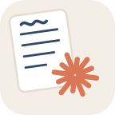
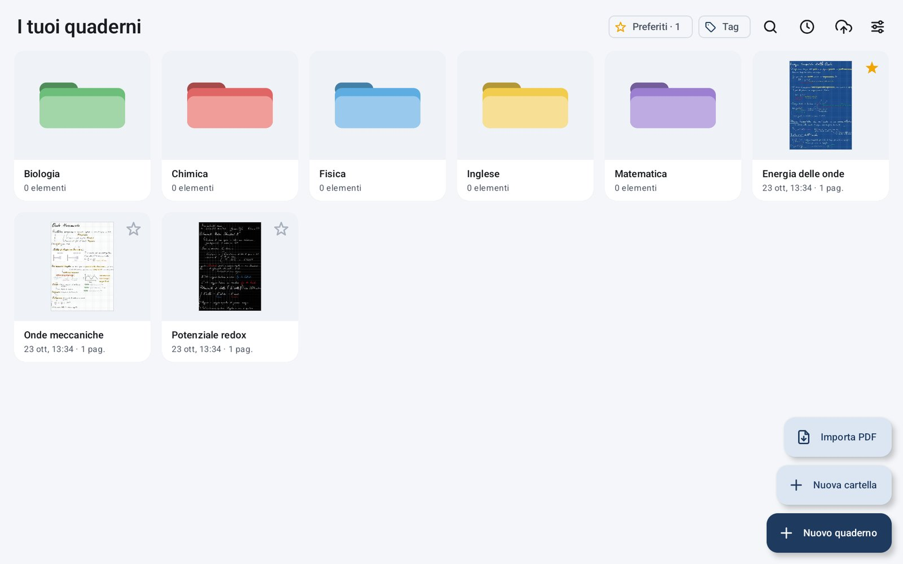
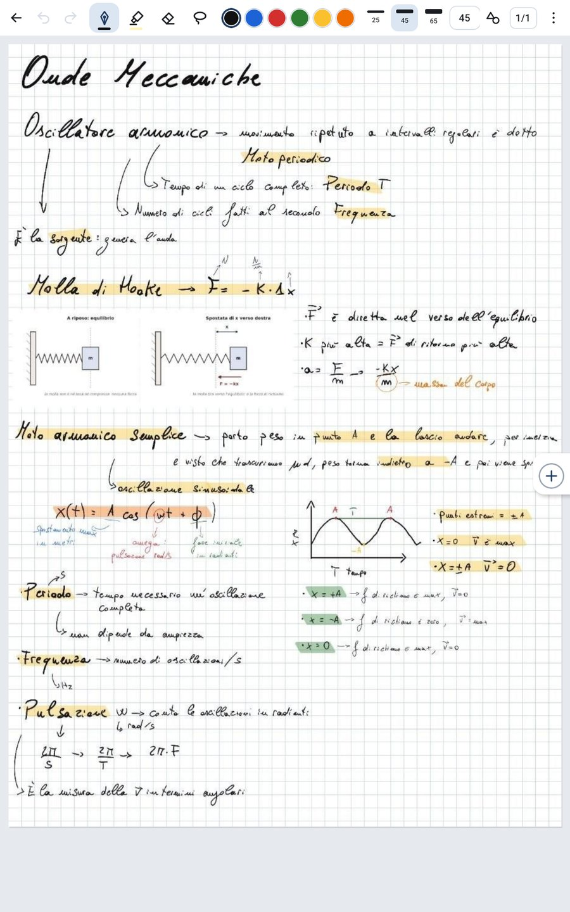
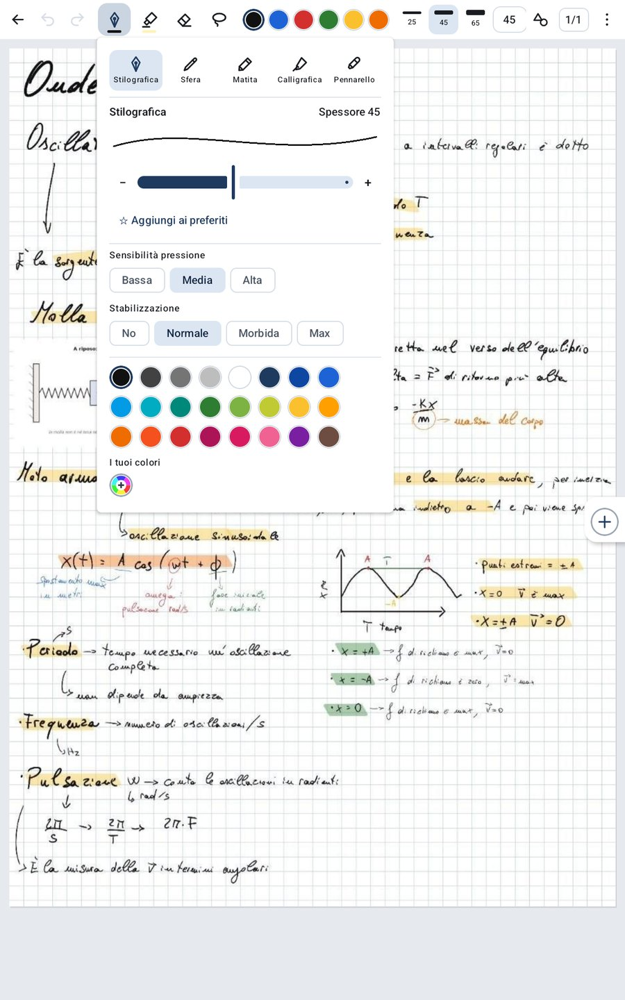
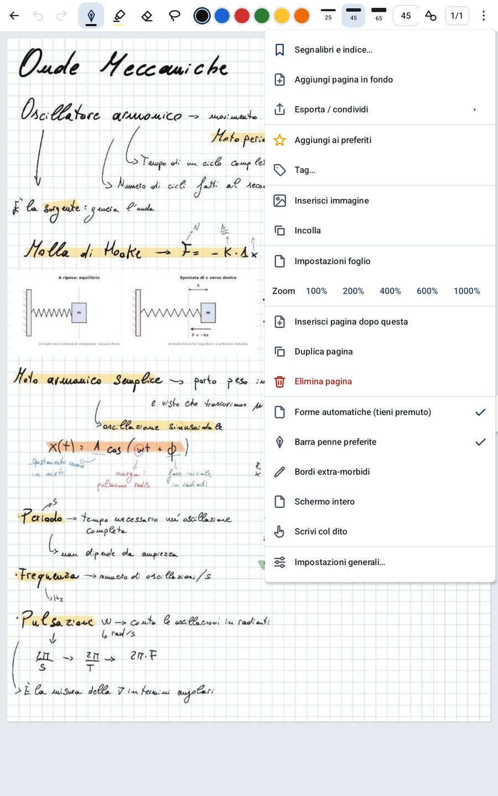
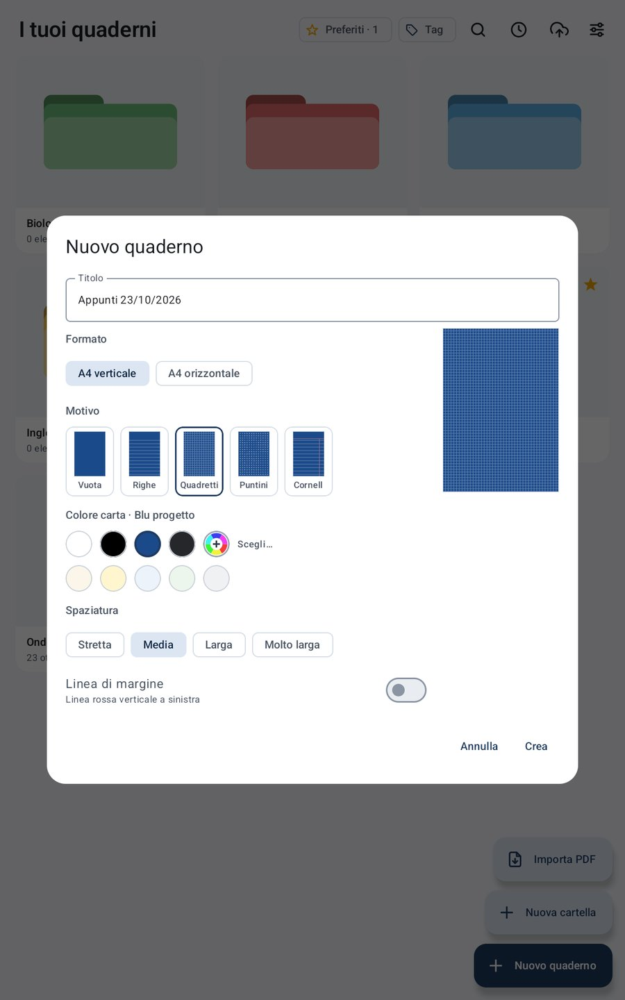
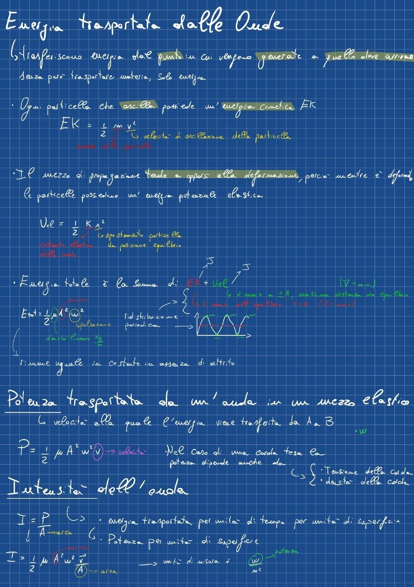
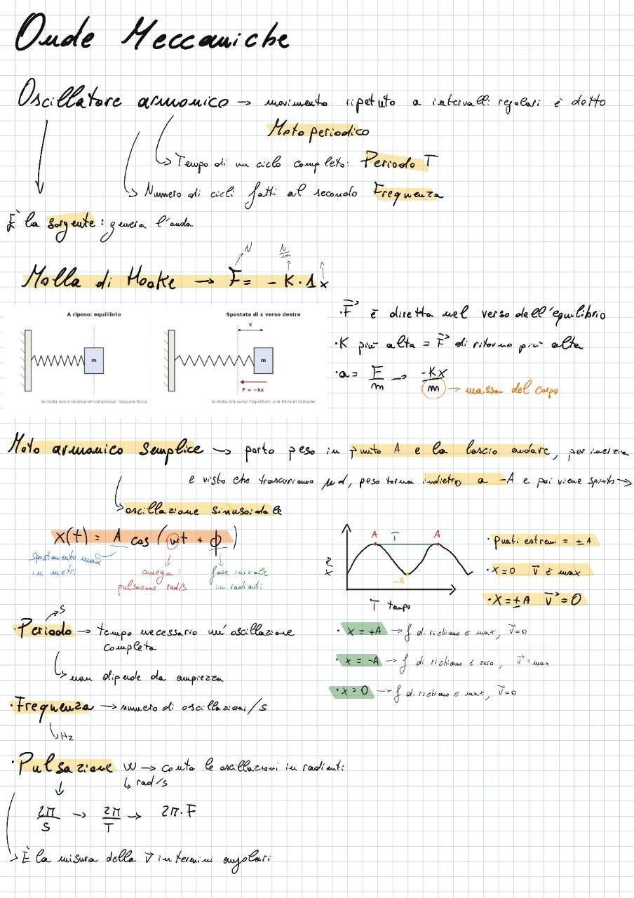
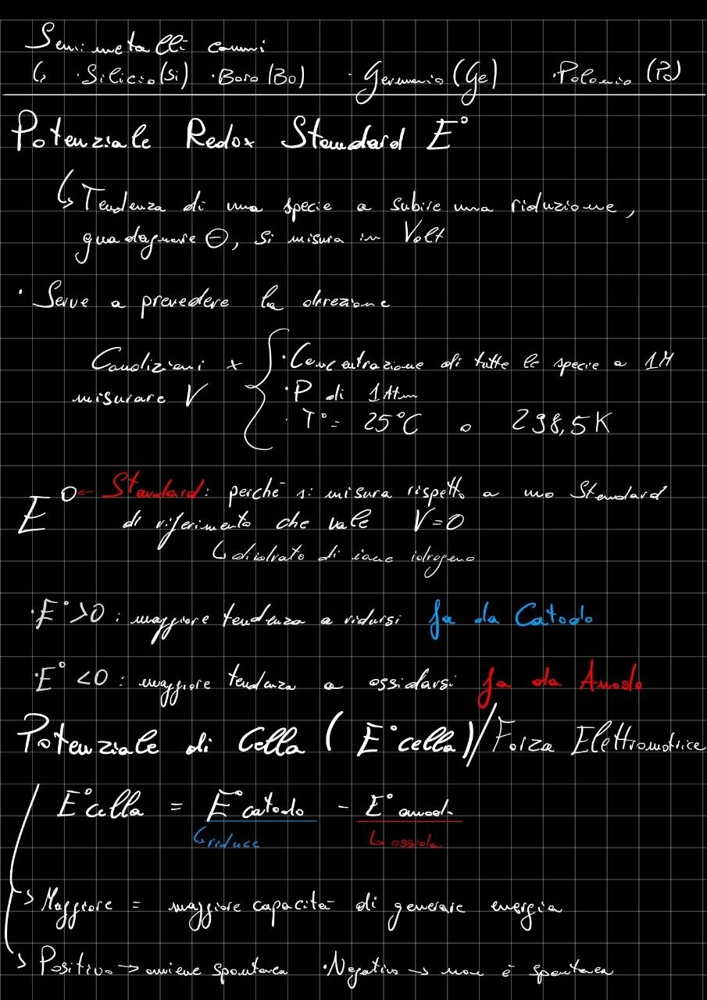

<div align="center">



# Tratto

**Appunti a mano per tablet Android con S Pen.**<br>
Inchiostro a bassa latenza, PDF **vettoriali** nitidi a qualsiasi zoom, tutto offline.


</div>

<p align="center">
  
</p>

<table>
  <tr>
    <td width="25%"></td>
    <td width="25%"></td>
    <td width="25%"></td>
    <td width="25%"></td>
  </tr>
  <tr>
    <td align="center"><sub>Il foglio, con una sola barra</sub></td>
    <td align="center"><sub>Penne, pressione e stabilizzazione</sub></td>
    <td align="center"><sub>Il menu ⋮ del foglio</sub></td>
    <td align="center"><sub>Formato, motivo e colore della carta</sub></td>
  </tr>
</table>

<p align="center">
  
  
  
  <br><sub>Pagine di appunti su carta blu, bianca e nera (OLED)</sub>
</p>

---

## Perché

Le app di note scritte a mano di solito esportano le pagine come **immagini**: il PDF che si ottiene è sgranato appena si
ingrandisce, pesa molto e il testo dei PDF importati smette di essere selezionabile.

Tratto nasce per risolvere questo problema e si regge su due regole:

1. **La penna deve essere fluida** come quella di Samsung Notes: è la cosa più importante.
2. **L'esportazione deve essere vettoriale**: ogni tratto diventa un tracciato nel PDF, nitido al 100% come al 6400%.
   Se il quaderno nasce da un PDF importato, quel PDF resta intatto e l'inchiostro gli viene scritto sopra.

Tratto è un'app personale, pensata per prendere appunti a lezione e studiare su un Galaxy Tab con S Pen. Funziona su
qualsiasi tablet Android 14+ con un pennino.

## Funzioni

### ✍️ Scrittura
- Inchiostro **[androidx.ink](https://developer.android.com/jetpack/androidx/releases/ink)** a bassa latenza, con previsione del movimento.
- Cinque penne: stilografica, penna a sfera, matita, calligrafica e pennarello, più l'evidenziatore.
- Spessore da 1 a 100, con scala esponenziale: il livello 1 resta sottile anche a zoom altissimi. A scelta, lo spessore può seguire lo zoom.
- Sensibilità alla pressione su 3 livelli e stabilizzazione del tratto su 4 livelli, memorizzate in ogni tratto.
- Zoom fino al **1000%**: le curve si infittiscono (Catmull-Rom) e restano lisce.
- Il palmo appoggiato viene ignorato. Toccando con due dita si annulla. Si può abilitare la scrittura col dito.
- Il tasto laterale della S Pen è disattivato apposta, così non attiva gomme per sbaglio. Un cerchietto in hover mostra dove e quanto grande si scriverà.
- Colori e spessori rapidi nella barra (0–12 colori e 0–6 spessori, modificabili), tavolozza completa, selettore HSV e penne preferite in una barra laterale.

### 🧰 Strumenti
- Gomma che cancella il tratto intero oppure solo la parte toccata.
- **Lazo**: sposta, ridimensiona, ricolora, duplica, elimina, copia e incolla, anche fra quaderni diversi. Funziona anche su foto e immagini.
- **Forme automatiche**: tieni premuto alla fine del tratto, oppure attiva la modalità Forme. Ci sono anche la **linea dritta**, che si aggancia a 0°, 45° e 90°, e il blocco dello zoom.
- Foto dalla galleria e immagini incollate da altre app, salvate in WebP (PNG solo se hanno parti trasparenti).
- Annulla e ripeti, una sola barra compatta in alto e lo **schermo intero** (senza ora né barra in basso, acceso di serie).

### 📄 Fogli
- A4 verticale e orizzontale.
- Fogli vuoti, a righe, a quadretti, a puntini o Cornell, con spaziatura regolabile e linea di margine.
- Carta bianca, **nera (OLED)**, blu progetto, grafite, tinte chiare o un colore libero. Righe e quadretti si adattano alla carta per restare visibili.
- Vista a griglia delle pagine: vai a una pagina, inserisci, duplica, sposta o elimina.
- Segnalibri sulle pagine.

### 📕 PDF
- Importa un PDF dalla libreria, oppure con "Apri con" o "Condividi" da qualsiasi app. Ogni pagina del PDF diventa una pagina del quaderno.
- Si scrive, si evidenzia e si usa il lazo come su un foglio normale, e si possono inserire pagine bianche fra quelle del PDF.
- Il PDF resta **nitido allo zoom**: oltre una certa soglia viene ridisegnata solo la zona visibile, alla risoluzione esatta.
- **Indice del PDF** navigabile.
- In esportazione il PDF originale resta intatto (scansioni non ricompresse, testo selezionabile, segnalibri) e l'inchiostro si aggiunge come tracciati vettoriali con [PdfBox-Android](https://github.com/TomRoush/PdfBox-Android).

### 🔗 Collegamenti
- Con il lazo si seleziona una zona e si sceglie **"Collega a…"**: si sfogliano le cartelle o si cerca, poi si collega un quaderno intero oppure una sua pagina.
- Un tocco col dito sul collegamento lo apre, e "← Torna" riporta dove eri.
- Anche nel **PDF esportato** i collegamenti si possono cliccare. Quelli verso un altro quaderno funzionano nella copia sincronizzata, con percorsi relativi, nei lettori PDF da computer.
- **Grafo dei collegamenti**, come quello di Obsidian: un pallino per quaderno, una linea per ogni collegamento, i colori delle materie. Le materie si raccolgono in grappoli, i pallini si trascinano e le linee li seguono come molle. Un tocco mostra i quaderni collegati, un secondo tocco apre il quaderno. Il grafo si costruisce solo dai `meta.json`, senza caricare i tratti, quindi resta leggero anche con centinaia di quaderni.

### 🗂️ Libreria
- Cartelle annidate in 12 colori, quaderni **preferiti** sempre in cima, **tag** colorati e **ricerca** in tutte le cartelle, senza badare a maiuscole e accenti.
- **Recenti**: i quaderni aperti di recente si riaprono sulla pagina dove li avevi lasciati.
- Ordine per nome ("Lezione 2" viene prima di "Lezione 10"), per data di creazione o per ultima modifica.
- Selezione multipla con pressione lunga: sposta, rinomina, colora, aggiungi tag, elimina.
- Copertine generate dalla prima pagina.

### 📤 Esportazione e sincronizzazione
- PDF vettoriale del quaderno intero o di **pagine scelte** (per esempio "1-5, 8", "solo con appunti", "solo con segnalibro"), oppure PNG, tramite il menu Condividi di Android.
- **Sincronizzazione con una cartella**, per esempio su Google Drive:
  - Tratto copia il PDF di ogni quaderno ripetendo lo stesso albero di cartelle.
  - Riscrive solo i quaderni cambiati e segue rinomine, spostamenti ed eliminazioni.
  - Non sovrascrive mai file che non ha scritto lui.

### 🔒 Privacy e affidabilità
- **Nessun permesso Android**, nemmeno Internet: tutto resta sul tablet, tranne quello che scegli tu di condividere o sincronizzare.
- Salvataggio automatico mentre scrivi e quando l'app va in secondo piano. Ogni salvataggio è atomico e tiene una copia di sicurezza: se un file si rovina, l'app recupera tutto quello che è ancora leggibile.

## Come funziona l'esportazione vettoriale

```
tratto Ink ──► contorno (androidx.ink) ──► android.graphics.Path ──► PDF (tracciato pieno)
                                                     │
                       PDF importato? ──► PdfBox-Android scrive i tracciati sopra le pagine originali
```

Ogni tratto viene salvato con i suoi punti di input, cioè posizione, pressione e tempo. In esportazione Ink ne calcola il
contorno e il contorno diventa un tracciato PDF: la nitidezza non dipende da alcuna risoluzione. Lo script
[`scripts/check_pdf_vector.py`](scripts/check_pdf_vector.py) verifica che un PDF esportato non contenga immagini, a parte
le foto inserite di proposito. Quelle vanno nel PDF in JPEG alla risoluzione che serve (200 dpi alla misura con cui sono
posate): il PDF di Android le salverebbe senza perdita, tre volte più pesanti.

## Installazione

Tratto non è sul Play Store: si installa l'APK direttamente sul tablet.

1. Compila l'APK (vedi sotto) o procuratelo da chi lo compila.
2. Copialo sul tablet e aprilo, consentendo l'installazione da origini sconosciute.
3. Gli aggiornamenti si installano **sopra** la versione precedente: quaderni e impostazioni restano.

> [!IMPORTANT]
> Android accetta un aggiornamento solo se è firmato con la **stessa chiave** della versione installata. Gli APK di
> release sono firmati con la chiave di debug di chi li compila: se cambia chi compila, prima di installare bisogna
> disinstallare, e così si perdono i quaderni. Conviene sempre esportarli o sincronizzarli prima.

## Compilare

Servono **JDK 21** e l'**Android SDK** con la piattaforma 36 e i build-tools 36.1.0. Gradle si scarica da solo con il wrapper.

```bash
git clone https://github.com/lampedev/tratto.git
cd tratto
echo "sdk.dir=$HOME/Android/Sdk" > local.properties   # o la variabile ANDROID_HOME
./gradlew assembleRelease
```

Gli APK si trovano in `app/build/outputs/apk/release/`:

| File | Per |
|---|---|
| `app-arm64-v8a-release.apk` | tablet e telefoni (il più leggero) |
| `app-x86_64-release.apk` | emulatore |
| `app-universal-release.apk` | tutti e due |

[`env.sh`](env.sh) è un esempio di ambiente con JDK e SDK installati in `~/opt`: `source env.sh && ./gradlew assembleRelease`.

### Banco di prova JVM

[`tools/inkjvm`](tools/inkjvm) compila sul computer gli stessi sorgenti dell'app che riguardano pennelli, modello,
selezione, riconoscitore di forme e formato dei file, usando le librerie Ink per JVM, codice nativo compreso. Così si
possono provare forma dei tratti, forme e salvataggio senza un dispositivo:

```bash
cd tools/inkjvm && ./gradlew run
```

## Struttura del codice

```
app/src/main/java/com/caro/tratto/
├── MainActivity.kt          libreria ⇄ grafo ⇄ editor, PDF ricevuti da altre app
├── ink/                     pennelli (famiglie androidx.ink, pressione, stabilizzazione)
├── model/                   quaderno, pagine, tratti, collegamenti; motivi della carta
├── editor/                  EditorView: input della penna, zoom e scorrimento, una RenderNode per pagina,
│                            lazo, gomma, forme, annulla/ripeti, cerchietto in hover
├── data/                    archivio su file (quaderni, cartelle, tag, recenti), formato strokes.bin,
│                            pagine e indice dei PDF
├── export/                  PDF/PNG, inchiostro sui PDF importati (PdfBox), collegamenti nel PDF,
│                            sincronizzazione su cartella (Storage Access Framework)
└── ui/                      schermate Compose: libreria, grafo, barra dell'editor, impostazioni, dialoghi
```

### Dove finiscono i dati

Tutto sta nella memoria privata dell'app (`filesDir`):

```
notebooks/<id>/meta.json       titolo, cartella, carta, preferito, tag
notebooks/<id>/strokes.bin     pagine e tratti (formato binario versionato, oggi v6) + strokes.bak di sicurezza
notebooks/<id>/source.pdf      il PDF originale, se il quaderno nasce da un PDF
notebooks/<id>/images/         foto inserite
notebooks/<id>/thumb.png       copertina
folders.json · tags.json · recent.json · sync.json
```

Ogni versione nuova di `strokes.bin` legge anche quelle vecchie.

## Tecnologie

| | |
|---|---|
| Linguaggio | Kotlin 2.4 (Kotlin integrato di AGP 9) |
| UI | Jetpack Compose, Material 3 |
| Inchiostro | androidx.ink 1.1 (authoring, brush, geometry, rendering, strokes, storage) e androidx.input motionprediction |
| PDF | `PdfRenderer` per la resa, `PdfDocument` per i quaderni, PdfBox-Android 2.0.27 per scrivere sui PDF importati |
| Build | Gradle 9.6, Android Gradle Plugin 9.4, compileSdk 36, minSdk 34 |

## Stato

Il progetto è giovane (versione **0.46**) e va avanti a piccoli passi: un miglioramento per versione, provato in
emulatore e poi sul tablet. Le prossime idee:

- caselle di testo;
- aggiungere le pagine di un PDF a un quaderno esistente;
- PDF esportati più leggeri, arrotondando le coordinate dei tracciati;
- apertura istantanea dei quaderni molto lunghi, una pagina alla volta.

## Riconoscimenti

- [androidx.ink](https://developer.android.com/jetpack/androidx/releases/ink) e [Jetpack Compose](https://developer.android.com/compose), Apache 2.0
- [PdfBox-Android](https://github.com/TomRoush/PdfBox-Android) di Tom Roush, port di [Apache PDFBox](https://pdfbox.apache.org/), Apache 2.0
